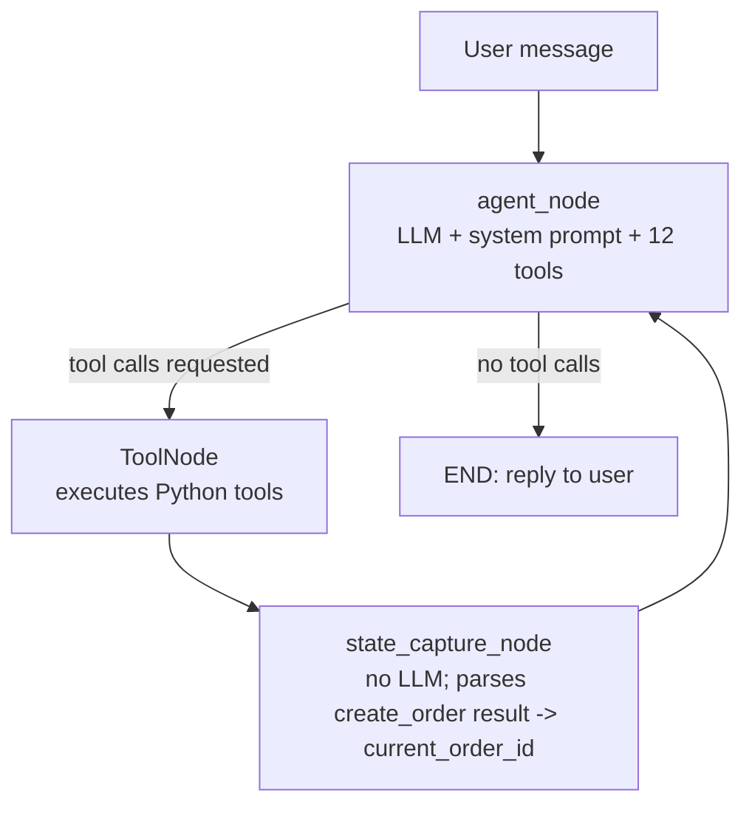

# Architecture

## Current (MVP)

Single agent, single graph, tools are HTTP clients over the restaurant POS.



A checkpointer (`MemorySaver`) saves state after every node, keyed by `thread_id`. One `thread_id` = one conversation.

### State
```python
class AgentState(TypedDict):
    messages: Annotated[list, add_messages]   # appended, not overwritten
    current_order_id: str | None              # set deterministically in code
```

### Nodes
| Node | Type | Job |
|---|---|---|
| `agent_node` | LLM call | Rebuilds system prompt each turn (business info + `current_order_id`), calls `ChatGroq.bind_tools(TOOLS)` |
| `tools` | `ToolNode` | Runs the tool the LLM requested, appends a `tool` message |
| `state_capture_node` | plain function | Scans trailing `ToolMessage`s for `create_order`, parses `order_id` JSON into state |
| `should_continue` | conditional edge | Returns `"tools"` if the last AI message has tool calls, else `END` |

The graph topology is static; routing is dynamic (decided by the LLM's output at runtime). The engine only orchestrates, applies reducers and checkpoints. The LLM never executes code.

### Startup data
`fetch_restaurant_static_info()` calls `GET /settings` and `GET /settings/status` once and injects business name, hours, open/closed, delivery fee and tax rate into the system prompt.

## Tools (all in `tools.py`)

| Tool | POS endpoint | Type |
|---|---|---|
| `search_menu` | `GET /menu/items?q=&available=True` | read |
| `list_menu` | `GET /categories`, `GET /menu` | read |
| `check_inventory` | `GET /menu/items/{id}` | read |
| `check_order_status` | `GET /orders/{id}` | read |
| `list_zones` | `GET /zones` | read |
| `check_delivery_availability` | `GET /zones` (name match) | read |
| `lookup_customer_by_phone` | `GET /customers/lookup` | read |
| `create_order` | `POST /orders` then `POST /orders/{id}/confirm` | write |
| `add_order_items` | `POST /orders/{id}/items` | write |
| `update_order_item` | `PATCH /orders/{id}/items/{item_id}` | write |
| `remove_order_item` | `DELETE /orders/{id}/items/{item_id}` | write |
| `cancel_order` | `POST /orders/{id}/cancel` | write |

`_pos_request(method, path, **kwargs)` uses a shared `requests.Session` with Bearer `POS_API_TOKEN`, returns JSON or an error string, never raises. `X-Action-Pin` is sent on `cancel_order` when `POS_ACTION_PIN` is set.

## Memory model
- **Working memory (per conversation):** the message list plus `current_order_id`, stored by the checkpointer under `thread_id`. No summarization or windowing: phone/text order chats are short.
- **Cross-conversation memory:** owned by the POS (customers, orders). The agent reads it via tools, and customers supply an order id to track an order. Not used for text-chat personalization.

## Target architecture (not built)
Router in front of two branches (information vs order), code-level guardrail nodes, a human-in-the-loop interrupt before `create_order`, escalation, a Postgres checkpointer, FastAPI service wrapper, structured logging/tracing, pytest suite, Docker. See `production_architecture.md` for the full target diagram and `production_readiness_audit.md` for the 12-category gap analysis.

## Related docs
- `planning/processes_for_agent.txt` — process map of a human taking an order, exceptions B1–B13, success criteria C1–C10
- `planning/intents_for_agent.txt` — 17 intents
- `planning/final_tool_list.txt` — original 14-tool list
- `planning/30_day_production_plan_v2.txt` — build order chosen by the owner
- POS API reference: `docs/ENDPOINTS.md` (81 endpoints).
