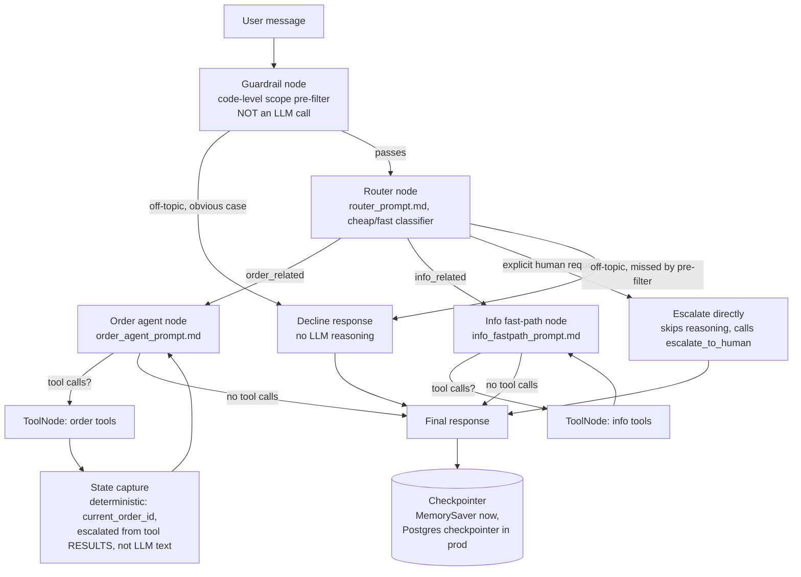

# Bella Cucina Agent — Production Graph Architecture

Consolidates every architectural decision made so far. This is the
target to build toward — not yet implemented in `milestone2_agent_langgraph.py`.

## Graph flow



## AgentState schema

```python
class AgentState(TypedDict):
    messages: Annotated[list[AnyMessage], add_messages]  # full history, no
                                                            # summarization —
                                                            # conversation is
                                                            # short enough
    current_order_id: str | None   # set deterministically by state-capture,
                                    # NOT extracted by the LLM
    customer_phone: str | None     # set if customer states it (tool-calling
                                    # extraction, via save_customer_info args)
    escalated: bool                # set deterministically when
                                    # escalate_to_human's tool call is
                                    # observed in results — code sets this,
                                    # not an LLM judgment call
    route: str | None              # set by the router node
```

## Node-by-node

| Node | What it does | LLM call? | Source of decision |
|---|---|---|---|
| **Guardrail** | Fast pre-filter for obviously off-topic input (keyword/regex or a tiny cheap check) | No (or a tiny cheap model, not the main one) | Defense-in-depth discussion — don't rely on prompt compliance alone |
| **Router** | Classifies message into order_related / info_related / escalation / off_topic | Yes, but a short/cheap classification prompt, not a conversational one | Maps to process map A2 ("determine intent"), made explicit |
| **Order agent** | Full tool-calling loop over the 9 order-management tools | Yes | Kept as ONE agent — order-taking, modification, cancellation, tracking share state and don't justify a split (handoff-tax reasoning) |
| **Info fast-path** | Lighter loop/single call over the 5 info tools | Yes, possibly a cheaper/faster model | Split out because it's stateless and lower-complexity — legitimate reason to split |
| **State capture** | Parses tool RESULTS (not LLM text) to set `current_order_id`/`escalated` | No | Deterministic-capture discussion — order_id is system-generated, never LLM-extracted |
| **Escalate (direct)** | Short-circuits straight to `escalate_to_human`, skips full reasoning for the unambiguous "explicit human request" case | No (or minimal) | Router already disambiguated this from the fuzzier "complaint" case, which still goes through the order/info agent's judgment |
| **Decline** | Canned off-topic response | No | Code-level guardrail enforcement, not prompt-dependent |
| **Checkpointer** | Persists `AgentState` after every node, keyed by `thread_id` | N/A | `MemorySaver` now; Postgres checkpointer in Phase 3 — swap only, no logic change |

## Tool distribution across branches

**Order agent (9 tools):** search_menu, check_inventory, create_order,
update_order, cancel_order, check_order_status, get_customer_order_history
*(built but currently unused — deferred, voice-channel-only)*,
save_customer_info, send_confirmation_email

**Info fast-path (5 tools):** list_menu, filter_menu, check_delivery_availability,
search_menu *(shared with order agent — menu lookup is needed in both
contexts)*, log_complaint *(cross-cutting — a complaint can surface in
either branch)*

**Escalation (1 tool):** escalate_to_human — reachable from either branch
AND directly from the router's short-circuit path

## Prompt file composition (8 files)

```
base_identity.md              (shared, all branches)
+ scope_guardrail.md          (B10 — cross-cutting)
+ escalation_rules.md         (B9 — cross-cutting)
+ allergy_safety_rule.md      (B11 — cross-cutting, highest-stakes)
+ payment_honesty_rule.md     (B13 — cross-cutting)
+ custom_modification_boundary.md  (B3 — order branch only, realistically)
+ order_agent_prompt.md       (order branch only)
  OR
+ info_fastpath_prompt.md     (info branch only)

router_prompt.md              (separate, NOT composed with the above —
                                the router isn't conversational)
```

## Memory strategy summary

Two independent systems, not one:

1. **Working memory** (this call only): full message list via `add_messages`
   reducer, checkpointed per `thread_id`. No summarization, no sliding
   window — conversation length doesn't justify the complexity at this
   scale. Resets to empty on a new `thread_id`, by design.

2. **Cross-call customer/order memory**: Postgres tables (`CUSTOMERS`,
   `ORDERS` — in-memory dicts in `tools.py` today), keyed by
   `customer_phone`, independent of `thread_id`. Currently NOT wired into
   automatic call-start lookup (that was scoped out — text channel only,
   no Caller ID available) — `get_customer_order_history` exists but is
   only reachable if the customer states their phone number in
   conversation, not proactively injected.

## Explicitly deferred / out of scope

- Reservation tools, payment gateway, apply_discount, update_delivery_address,
  reschedule_order — flagged in tool inventory, not built
- Automatic phone-based greeting/history lookup — voice-channel-only,
  deferred since no real Caller ID exists on text channel
- Summarization/sliding-window memory — not needed at this conversation
  scale
- Voice/Twilio integration, admin dashboard — deprioritized per interview
  timeline

## Status: what's designed vs. what's built

**Designed but NOT yet implemented in code:** the entire router +
two-branch split, the code-level guardrail node, the state-capture node,
the 8-file prompt structure. `milestone2_agent_langgraph.py` still reflects
the single-agent-node architecture from before this design session.

**Built and working:** all 14 tools in `tools.py`, the knowledge base with
spice/dietary/delivery-zip fields, the original single-agent LangGraph
loop (pre-router), the process map and intent taxonomy this architecture
derives from.
